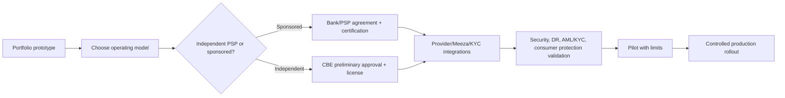

# DONECASH — Research Brief and Product Decisions

English handover edition · Research snapshot: 13 September 2026. Market figures and regulatory references below describe the original research snapshot, not a fresh legal determination.

## Executive summary

DONECASH should compete through operational trust: a clear recipient check, visible fees, honest processing states and traceable financial operations. It should not be presented merely as a visual copy of an existing wallet.

The NTRA Q2 2025 report recorded 46.3 million active wallets, 718 million transactions and EGP 943 billion in transaction value; P2P represented 71% of value. The CBE financial-inclusion strategy reported 77.6% inclusion at the end of 2025, representing 54.7 million people. These are source-period figures and not projections of DONECASH adoption.

## Product thesis

**Clear before you send. Traceable after you send.**

1. **Confirm with confidence:** show the masked recipient, amount, fee and total debit before authorization.
2. **Never guess the status:** a timeout means processing until authoritative confirmation, not automatic failure.
3. **Operations-grade by design:** connect every payment to ledger, provider, reconciliation, support and audit evidence.

## Market interpretation

| Signal | Evidence in the original research | Product implication |
|---|---|---|
| P2P dominates value | 71% of Q2 2025 transaction value | Make transfers the MVP's core journey |
| Bank-to-wallet funding matters | InstaPay accounted for 65% of reported funding sources | Plan a sponsor-backed bank/network adapter |
| Core services are common | Vodafone, Orange and e& advertise transfers, cash services and bills | Differentiate through clarity and reliability |
| Accessibility is a visible regulatory requirement | NTRA instructions issued in 2024 | Treat accessibility as Must, not decoration |
| eKYC is evolving | CBE digital-financial-identity framework referenced in August 2026 | Isolate identity integration behind an adapter |
| Payment licensing has broadened | PSP/PSO rules issued in 2025 | Choose sponsor/licensing model before production |

## Functional benchmark

| Capability | Vodafone Cash | Orange Cash | e& money | DONECASH planned scope |
|---|---|---|---|---|
| Wallet transfers | Advertised | Advertised | Advertised | MVP |
| ATM/agent cash-in and cash-out | Advertised | Advertised | Advertised | MVP via adapter/simulator |
| Bills and top-up | Advertised | Advertised | Advertised | MVP |
| Merchant QR | Not established from the source used | Advertised | Advertised | MVP |
| Virtual card | Shopping services depend on channel | Mentioned within wallet ecosystem | Advertised | Later |
| Incoming international remittance | Partner-dependent | Advertised through NBE partners | Not established from the source used | Later |
| Explainable pending and operations trace | Not assessable from public pages | Not assessable | Not assessable | Proposed differentiator |

This is an inventory of public claims as of the research date, not a quality ranking or a hands-on competitor usability study.

## Practical operating-model path

A portfolio prototype can simulate payments. A real wallet needs an approved legal operating model: a sponsoring bank/eligible licensed partner or the appropriate independent licensing route. Contracts, scheme access, security, disaster recovery, AML/KYC, customer protection and pilot approval precede production. Apple’s cited review guidelines also require appropriate legal-entity submission for highly regulated financial services.

## Limits are policy, not constants

The source review found different published individual limits: CBE/NTRA public pages referenced EGP 30,000 daily and EGP 100,000 monthly, while the Orange page referenced EGP 60,000 daily, EGP 200,000 monthly and a maximum wallet value of EGP 200,000. Do not select an arbitrary value from that discrepancy.

- Store versioned, effective-dated `limit_policies`.
- Record the policy version used for each decision.
- Publish through maker-checker approval.
- Obtain written sponsor/compliance confirmation of applicable values during UAT.
- Label prototype fees and limits as illustrative.

## Technology decision

- React Native/Expo for native camera, biometrics, secure storage, push and device trust.
- Next.js for the backoffice and a future merchant portal; a PWA is an optional presentation channel.
- NestJS modular monolith with explicit domain boundaries and transactional outbox.
- PostgreSQL/Prisma, retaining explicit SQL for ledger constraints and serializable posting.
- Redis/Upstash only for non-authoritative cache, throttling and ephemeral coordination.
- Docker Compose locally. Neon is a possible demo/preview database; regulated hosting needs appropriate SLA, residency, backup and contractual controls.

## Recommended portfolio narrative

Show the customer journey, operations trace, timeout recovery, architecture/ERD and the rationale for a modular monolith. Future development evidence should include concurrency, idempotency, audit and maker-checker tests. Two 90-second customer/operations videos are suggested presentation assets, **not existing deliverables in this package**.

The current deliverable demonstrates product thinking, financial-domain modeling and UX planning. Backend integrity and DevOps remain design intentions until implemented and tested.

## Sources

1. National Telecom Regulatory Authority, [Q2 2025 Mobile Wallet Usage Indicators](https://www.tra.gov.eg/en/ntra-issues-q2-2025-report-on-the-usage-indicators-of-mobile-wallets-operated-by-telecom-companies/), 10 September 2025.
2. Central Bank of Egypt, [Second Financial Inclusion Strategy 2026–2030](https://www.cbe.org.eg/en/news-publications/news/2026/02/17/14/44/financial-inclusion-2026), 17 February 2026.
3. Orange Egypt, [Orange Cash E-Wallet](https://www.orange.eg/en/services/Orange-financial-services), accessed 13 September 2026.
4. Vodafone Egypt, [Vodafone Cash](https://web.vodafone.com.eg/en/vodafone-cash), accessed 13 September 2026.
5. e& Egypt, [e& money](https://www.eand.com.eg/portal/pages/services/eand_money_en.html), accessed 13 September 2026.
6. NTRA, [Instructions for Mobile Wallet Accessibility](https://www.tra.gov.eg/en/ntra-issues-instructions-to-facilitate-the-use-of-mobile-e-wallet-services-for-people-of-determination/), 4 December 2024.
7. Central Bank of Egypt, [Digital Financial Identity](https://www.cbe.org.eg/en/payment-systems-and-services/digital-financial-identity), updated 23 August 2026.
8. Central Bank of Egypt, [PSO/PSP Licensing Rules](https://www.cbe.org.eg/en/news-publications/news/2025/06/19/08/20/psos-and-psps-licensing-rules), 19 June 2025.
9. Apple Developer, [App Review Guidelines](https://developer.apple.com/app-store/review/guidelines/), accessed 13 September 2026.
10. NTRA, [Mobile Wallets Regulatory Rules](https://www.tra.gov.eg/en/mobile-wallets-regulatory-rules/), accessed 13 September 2026.

