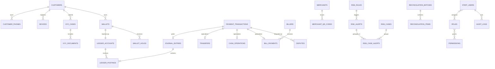
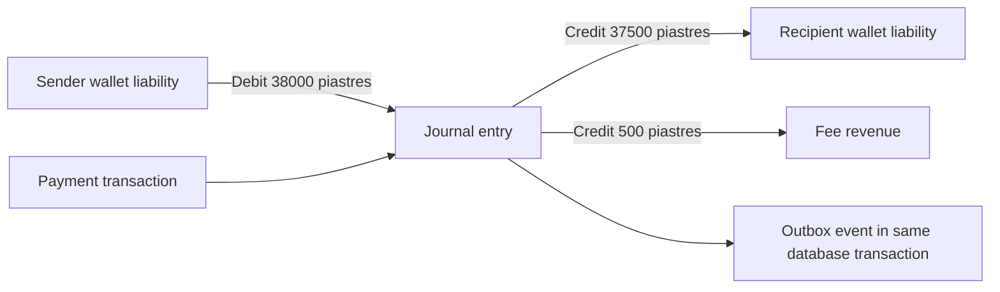

# DONECASH — Database Design

English handover edition · Physical baseline: [schema.sql](../database/schema.sql). The SQL is a design starting point, not evidence of a migrated or production-hardened database.

## 1. Design principles

- PostgreSQL is the financial source of truth; Redis is not authoritative for money or finality.
- Double-entry, append-only ledger; `BIGINT` minor units (EGP piastres), never floating-point arithmetic.
- Separate identity/KYC, wallet lifecycle and accounting permissions.
- UUID internal identifiers; public references plus provider/external and correlation identifiers.
- Preserve financial history through lifecycle/archival. Encrypt sensitive identity data and use keyed search hashes where appropriate.
- Fees, limits and risk rules are versioned and effective-dated.

## 2. Entity identification

| Domain | Entities | Responsibility |
|---|---|---|
| Identity | `customers`, `customer_phones`, `customer_consents`, `devices`, `auth_sessions`, `auth_challenges` | Identity, contacts, consent, device and sessions |
| KYC | `kyc_cases`, `kyc_documents`, `screening_results` | Verification workflow and evidence |
| Wallet | `wallets`, `wallet_holds`, `beneficiaries` | Wallet state, reservations and saved recipients |
| Ledger | `ledger_accounts`, `journal_entries`, `ledger_postings` | Accounting truth |
| Payments | `payment_transactions`, `transfers`, `cash_operations`, `billers`, `bill_payments`, `merchants`, `merchant_qr_codes` | Financial commands and rail-specific data |
| Policy | `fee_policies`, `limit_policies`, `limit_consumptions` | Pricing, limits and usage aggregates |
| Risk | `risk_rules`, `risk_alerts`, `risk_cases`, `risk_case_alerts` | Detection and investigation |
| Support | `disputes`, `support_tickets`, `ticket_events` | Complaints and communication |
| Operations | `reconciliation_batches`, `reconciliation_items`, `outbox_events`, `notifications` | Matching, reliable events and messages |
| IAM/audit | `staff_users`, `roles`, `permissions`, `staff_roles`, `role_permissions`, `approval_requests`, `audit_logs` | Access, segregation of duties and evidence |

## 3. Attribute identification

The SQL source is the exact per-entity attribute inventory: types, required values, defaults, foreign keys, checks and indexes. Common conventions:

| Attribute | Type | Rule |
|---|---|---|
| `id` | UUID | Internal, without business meaning |
| `created_at`, `updated_at` | timestamptz | Store instants in UTC; display local time explicitly |
| `version` | integer where present | Optimistic concurrency on mutable resources |
| `amount_minor` | bigint | Positive business amount; postings also carry a signed amount |
| `currency` | char(3) | Explicit EGP in MVP |
| `status` | text with CHECK | Enumerated lifecycle, not several ambiguous booleans |
| `external_reference` | text | Provider-scoped uniqueness where applicable |
| `idempotency_key` | text | Unique within the command's defined scope |
| `metadata`/payload | jsonb | Non-core extensions/evidence; not a substitute for relational facts |

### Sensitive data

National ID uses ciphertext plus keyed-HMAC lookup hash. The baseline stores E.164 phone text for demonstration; production must decide encryption/tokenization and indexed-hash strategy. KYC media belongs in encrypted object storage; SQL stores object keys, content hashes and retention information. MPIN credential storage is intentionally absent from the domain schema and needs an authenticated credential store, suitable KDF and key-management policy. Never infer that this baseline already supplies production authentication.

## 4. Relationship identification

- Customer 1:N phones; one active primary phone, globally unique phone value in the baseline.
- Customer 1:N KYC cases, preserving historical reviews.
- Customer 1:N wallets historically; partial uniqueness controls active phone/currency wallets.
- Wallet 1:1 customer ledger account; accounts classify assets, liabilities, equity, revenue, expense and clearing.
- Journal 1:N postings, with at least two balanced same-currency postings when postings are committed.
- Payment 0..1 journal in the baseline; unsuccessful requests need not post.
- Transfer 1:1 payment, with source/destination wallet references.
- Payment 1:N disputes; partial uniqueness prevents duplicate open reasons.
- Reconciliation batch 1:N items; a match may link a payment, while an exception remains unresolved.
- Staff N:M roles N:M permissions through join tables; approval separates maker and checker.

## 5. Entity relationship diagram

This overview shows the principal relationships; the SQL foreign keys are authoritative for the complete baseline.

### Ledger example: EGP 375 transfer + EGP 5 fee

In the SQL convention, debit is positive and credit negative: `38000 - 37500 - 500 = 0`. Wallet liabilities have their own normal-side interpretation. This corrects an arithmetic mismatch in the original explanatory diagram, which did not match its EGP 375 + 5 caption; it does not change the SQL sign convention.

## 6. Normalization to 3NF

### First normal form

Atomic columns; phones, devices, beneficiaries and KYC documents are rows in separate tables rather than lists embedded in text fields.

### Second normal form

Join-table data depends on the whole relationship key. Posting attributes depend on the posting, not only on its journal or account.

### Third normal form

Customer identity is not repeated in wallets/transfers. Biller descriptions live in `billers`; merchant data lives in `merchants`. Roles/permissions are separate entities. Batch metadata lives in the reconciliation batch rather than every item. Non-key facts depend on their entity key rather than transitively on another non-key attribute.

### Intentional read-side denormalization

- There is no authoritative `available_balance_minor` column on wallets. A future materialized projection may be rebuilt from ledger/holds.
- `limit_consumptions` is an operational aggregate; critical decisions need atomic consistency with payment commands.
- Historical receipt/counterparty snapshots may be stored in an explicit read model; `display_counterparty_name` is a proposed projection, not a column implemented in the baseline.

## 7. Constraints and indexes

The actual payment idempotency constraint is `(wallet_id, idempotency_key)`, not `(customer_id, idempotency_key)`. Provider references use `(provider_code, external_reference)`. Activity indexes include wallet/time; queues use status/time; active holds use a partial index. Business amounts are positive and signed postings nonzero. A deferred constraint trigger checks posting count, net amount and a single currency before commit. Update/delete of postings is blocked by an immutability trigger.

Use row locks or serializable transactions with bounded conflict retry for reserving funds, limit consumption and posting. ORM convenience must not weaken database invariants.

### Baseline gaps requiring hardening

The balance trigger fires on posting changes; a journal created without postings is not itself rejected by that trigger. It checks one posting currency but does not enforce matching journal/account currency. It does not by itself implement non-negative available balances, authorization, policy selection, payload-aware idempotency or immutable journal metadata. Quotes, provider inbox and extended merchant settlement/partial-refund models need explicit persistence decisions. See [delivery status](../handover/DELIVERY-STATUS.md); do not describe the baseline as a complete production financial database.

## 8. State machines

| Entity | Main path | Alternative paths |
|---|---|---|
| Payment | CREATED → AUTHORIZED → PROCESSING → COMPLETED | DECLINED before execution; FAILED only after authoritative negative finality; eligible cancellation; COMPLETED → REVERSAL_PENDING → REVERSED |
| KYC | DRAFT → SUBMITTED → IN_REVIEW → APPROVED | MORE_INFO_REQUIRED, REJECTED, EXPIRED |
| Wallet | PENDING_KYC → ACTIVE | RESTRICTED, SUSPENDED, CLOSED under guarded transitions |

CHECK constraints enumerate states; transition legality is an additional domain/database implementation requirement.

## 9. Partitioning and retention

Start without speculative partitioning. Measure volume before considering monthly ledger/audit/outbox partitions and compatible keys/indexes. Financial retention comes from legal/sponsor requirements, not arbitrary code constants. KYC objects need malware scanning, retention tags, legal holds, encryption and short-lived signed access. Copy audit evidence to appropriate immutable/WORM storage and verify signed batches or hash integrity.

## 10. Physical SQL handoff

Use [schema.sql](../database/schema.sql) as the baseline for a dedicated migration role. Application roles must not own financial tables. Review account classes and debit/credit rules with finance; agree provider reference/status semantics; create Prisma models/migrations while retaining SQL triggers/partial indexes; add property-based and concurrency tests for balancing, duplicate commands, holds, non-negative funds and linked reversals.

The English delivery changes the customer's default locale to `en-EG`; it retains multilingual identity fields for future Arabic localization. No Prisma schema or applied migration history is included.

## Sources

1. Prisma, [Transactions and Batch Queries](https://www.prisma.io/docs/orm/v6/prisma-client/queries/transactions), accessed 13 September 2026.
2. Central Bank of Egypt, [Mobile Wallets](https://www.cbe.org.eg/en/payment-systems-and-services/payment-services/mobile-wallet), accessed 13 September 2026.
3. Central Bank of Egypt, [PSOs and PSPs Licensing Rules](https://www.cbe.org.eg/en/payment-systems-and-services/payment-systems-and-services-oversight/psos-and-psps-licensing-rules), 2025.

