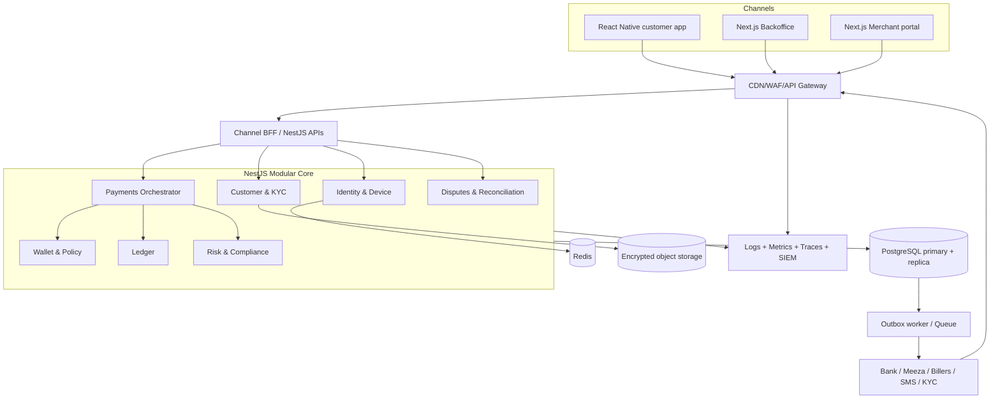
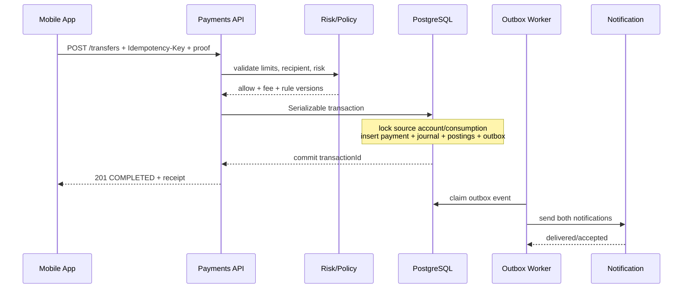

# DONECASH — Technical Design

English handover edition · Proposed architecture and API contract. There is no implemented NestJS/Next.js/React Native application in this package.

## 1. Technology decisions

| Layer | Recommendation | Rationale |
|---|---|---|
| Customer app | React Native + Expo development client | JavaScript ecosystem with native camera, secure storage, biometrics and notifications |
| Backoffice/merchant web | Next.js + TypeScript | Role-aware forms, operations workspaces and accessible web UI |
| API/domain | NestJS modular monolith | Explicit boundaries, dependency injection and lower initial operational complexity |
| Financial database | PostgreSQL + Prisma + reviewed SQL | Transactions, constraints, locks and migration control |
| Ephemeral infrastructure | Redis | Throttling/cache/coordination; never authoritative balance |
| Asynchronous work | BullMQ + transactional outbox | Retryable delivery without losing committed financial events |
| Media | Encrypted S3-compatible storage | Controlled KYC evidence lifecycle and signed access |
| Observability | OpenTelemetry, metrics and redacted structured logs | Trace API, worker and provider causality |
| Local development | Docker Compose | Repeatable PostgreSQL/Redis/object-storage environment |

Neon and Upstash can support portfolio/preview environments where service limits and latency fit. Regulated production selection requires residency, SLA, backups, failover, predictable connections, key management and contractual review. A hosted product name is not an automatic production approval.

## 2. Bounded contexts

| Context | Owns |
|---|---|
| Identity/access | Customer identity, sessions, consent and device trust |
| KYC/compliance | Verification, screening and review |
| Wallet/ledger | Wallet lifecycle, holds, accounts and journals |
| Payments | Quotes, orchestration and rail finality |
| Policy/risk | Fees, limits, rule evaluation and cases |
| Support | Tickets, disputes and customer communication |
| Operations/finance | Reconciliation, approvals and reports |
| Platform | Outbox/inbox, notifications, audit, secrets and telemetry |

Use ports rather than importing another module's persistence internals. Ledger posting has one controlled entry point. Avoid cyclic dependencies and provider-specific statuses in the domain. Extract services only when ownership, independent scaling or isolation requirements justify it.

## 3. System architecture

A modular monolith enables atomic ledger/outbox commits, easier debugging and fewer distributed failure modes. Workers may deploy separately while retaining domain contracts. External calls must not run inside a long-lived financial database transaction.

## 4. API design

### Common contract

- Customer base: `/api/v1`; UTF-8 JSON. Example amount: `{ "amountMinor": 37500, "currency": "EGP" }`.
- Staff authentication: OAuth/OIDC. Customer sessions: short-lived access credentials and rotating refresh tokens.
- Financial POST commands require `Idempotency-Key`; accept or generate `X-Correlation-ID`.
- Changed request content under an existing key returns a conflict, not another payment.
- Administrative updates use `If-Match`/version checks.
- Cursor pagination: `?limit=20&after=...`; ownership and permission checks on each resource.
- Problem Details fields: `type`, `title`, `status`, `code`, `detail`, `correlationId`, `fieldErrors`; no secrets.
- Webhooks use authenticated signatures/mTLS, timestamp/replay protection, inbox deduplication and fast acknowledgement before asynchronous work.

### Identity and onboarding

| Method | Path | Purpose | Authorization |
|---|---|---|---|
| POST | `/auth/otp/challenges` | Start registration/login/step-up OTP | Public, rate-limited |
| POST | `/auth/otp/challenges/{id}/verify` | Verify challenge | Public, challenge-bound |
| POST | `/auth/mpin/setup` | Set MPIN after strong proof | Enrollment token |
| POST | `/auth/sessions` | MPIN/device login | Device proof |
| POST | `/auth/sessions/refresh` | Rotate refresh credentials | Refresh token |
| DELETE | `/auth/sessions/{id}` | Revoke session/device | Customer ownership |
| POST | `/customers` | Create draft customer | Enrollment token |
| GET | `/customers/me` | Profile and status | Customer |
| POST | `/customers/me/consents` | Record versioned consent | Customer |
| POST | `/kyc/cases` | Start verification | Customer |
| POST | `/kyc/cases/{id}/documents/upload-url` | Short-lived upload URL | Customer ownership |
| POST | `/kyc/cases/{id}/submit` | Submit review | Customer ownership |
| GET | `/kyc/cases/{id}` | Verification status | Customer ownership |

### Wallet and P2P

| Method | Path | Purpose / controls |
|---|---|---|
| GET | `/wallets/me` | Available balance, holds and limits; safe short-lived caching |
| GET | `/wallets/me/activity` | Cursor-filtered history |
| GET | `/transactions/{publicId}` | Owned details and receipt |
| POST | `/recipients/resolve` | Masked name/eligibility; enumeration protection |
| GET / POST | `/beneficiaries` | List/add; step-up for sensitive addition |
| DELETE | `/beneficiaries/{id}` | Audited logical removal |
| POST | `/transfers/quotes` | Fees, limits and signed expiry |
| POST | `/transfers` | Quote-bound, authorized, idempotent execution |
| POST | `/transactions/{id}/reversal-requests` | Controlled request, not direct reversal |

### Cash, bills and merchants

| Method | Path | Purpose |
|---|---|---|
| POST | `/cash-out/quotes` | Fees and channel availability |
| POST | `/cash-out/requests` | Authorized withdrawal code and reservation |
| GET | `/cash-out/requests/{id}` | Status/expiry; never credential hashes |
| POST | `/cash-in/requests` | Deposit reference and channel instructions |
| GET | `/billers` | Catalog/categories |
| POST | `/bill-inquiries` | Inquiry without debit |
| POST | `/bill-payments` | Authorized payment from valid inquiry |
| POST | `/merchant-qr/resolve` | Validate QR and merchant |
| POST | `/merchant-payments` | Merchant payment |
| GET | `/merchants/me/settlements` | Merchant statement |
| POST | `/merchants/me/qr-codes` | Static/dynamic merchant QR |

### Support and notifications

| Method | Path | Purpose |
|---|---|---|
| POST | `/disputes` | Create eligible transaction-linked case |
| GET | `/disputes` | Customer's cases |
| GET | `/disputes/{id}` | Timeline/SLA |
| POST | `/disputes/{id}/messages` | Evidence/additional information |
| GET | `/notifications` | Inbox |
| PATCH | `/notifications/{id}` | Owned read status only |

### Backoffice base: `/ops/v1`

| Method | Path | Permission / guard |
|---|---|---|
| GET | `/customers/search` | `customer:search`, access reason |
| GET | `/customers/{id}/overview` | Scoped `customer:read_sensitive` |
| GET | `/kyc/cases` | `kyc:review` |
| POST | `/kyc/cases/{id}/decisions` | `kyc:decide`, reason and approval policy |
| GET | `/transactions/{id}/trace` | `transaction:trace` |
| POST | `/wallets/{id}/hold-requests` | `wallet:restrict`, approval |
| GET / PATCH | `/risk/cases/{id}` | `risk:investigate` |
| GET / PATCH | `/support/tickets/{id}` | `support:manage` |
| POST | `/reconciliation/batches` | `recon:import` |
| GET | `/reconciliation/batches/{id}/exceptions` | `recon:review` |
| POST | `/reconciliation/items/{id}/resolution-requests` | `recon:adjust`, approval |
| GET / POST | `/policies/fees` | `policy:author` |
| GET / POST | `/policies/limits` | `policy:author` |
| POST | `/approval-requests/{id}/decisions` | `approval:decide`, checker different from maker |
| GET | `/audit/events` | `audit:read` |

This is the baseline endpoint inventory, not a complete executable OpenAPI document. Extended risk-rule/template/staff/report APIs and detailed request/response schemas need specification during implementation.

### Webhooks base: `/webhooks/v1`

- `POST /providers/{providerCode}/transactions`
- `POST /providers/{providerCode}/kyc-results`
- `POST /providers/{providerCode}/bill-status`
- `POST /providers/{providerCode}/cash-status`

Persist authenticated events in a provider inbox/deduplication store before internal processing. This inbox is a required extension, not a table in the current SQL. Guard out-of-order transitions using provider sequence/authoritative inquiry and explicit state rules.

## 5. Financial execution

For an internal P2P command: validate proof/quote/recipient/policy/risk; use a short serializable transaction; lock relevant account/limit resources; persist payment, balanced journal, postings and outbox atomically; return the committed result; send notifications asynchronously.

For external rails: reserve funds, enter processing, call the provider outside the database transaction, then capture/release once through authenticated webhook or inquiry. An unknown outcome must not be changed to failed merely because the request timed out.

## 6. Security considerations

| Threat | Required controls |
|---|---|
| Account takeover/SIM swap | Device binding, OTP throttling, recovery cooldown, risk signals |
| Recipient enumeration | Masking, bounded lookup, rate limits and abuse monitoring |
| Duplicate/replayed payment | Payload-aware idempotency, signed authorization, unique provider events |
| Overspend/race | Serializable/locked reservations and atomic limit consumption |
| Forged/out-of-order webhook | mTLS/HMAC/JWS, replay window, inbox and state guards |
| Staff misuse | Least privilege, access reasons, maker-checker, immutable audit |
| KYC exposure | Encrypted object storage, short-lived signed URLs and audited watermarked viewing |
| Injection/broken access | Validation, parameterized queries, ownership checks, ASVS verification |
| Secret leakage | Secrets manager, rotation, redacted telemetry and no client provider credentials |
| Supply-chain/device compromise | Dependency/SBOM controls, MASVS and attestation as risk input |

### Mobile

Keychain/Keystore, LocalAuthentication/BiometricPrompt, screen privacy for sensitive views, minimal permissions, verified links and authenticated API requests. Biometrics unlock local keys; no face/fingerprint template is sent to DONECASH. App Attest/Play Integrity requires server verification and a safe unsupported-device fallback.

### API and backoffice

OIDC/SSO and phishing-resistant staff MFA; secure HttpOnly/SameSite cookies where appropriate; CSRF/CSP controls for browser sessions; least-privilege database roles; encrypted backups; controlled signed exports; audit read and write access. Use NIST authentication guidance and ASVS/MASVS as review baselines, not as unearned compliance labels.

### PCI and consumer protection

Hosted/tokenized card collection reduces PAN exposure but does not automatically remove PCI scope. No PAN/CVV should traverse the application servers in the intended card-funding model. Show fees, references, honest statuses, dispute pathways and accessible controls. Avoid disclosing fraud rules or internal provider errors.

## 7. Deployment strategy

| Environment | Data and purpose |
|---|---|
| Local | Docker, synthetic data and fake adapters |
| Preview | Isolated branch/review deployment, no production secrets |
| Integration/sandbox | Contract tests and provider credentials scoped to sandbox |
| Staging/UAT | Production-like controls and agreed partner scenarios |
| Production | Approved infrastructure, restricted deployment and real-money gates |

### Pipeline

Lint/types/unit tests → dependency/secret/SAST checks → integration/property/concurrency tests → migration validation → build/sign artifacts and SBOM → staging smoke/security/partner UAT → approved progressive release with rollback/runbook. Use expand-contract migrations and restore evidence; never rely on destructive schema rollback for financial history.

### Topology

Portfolio: API/workers, Next.js and managed PostgreSQL with fake providers. Regulated: controlled ingress/WAF, redundant application capacity, isolated workers, HA PostgreSQL, secrets/KMS, encrypted object storage, central telemetry and an approved recovery site. Choose container orchestration only to match actual operational needs.

### SLO and disaster recovery

Proposed financial SLO 99.95%, non-critical 99.9%, RPO ≤5 minutes and RTO ≤60 minutes. Monitor provider-specific success/latency, pending exposure, outbox age and reconciliation breaks. Test restore/failover and payment-state recovery; these targets have not been measured in this package.

## 8. Development sequence

| Sprint | Focus |
|---|---|
| 0 | Scope/design sign-off, threat model, provider contracts and CI skeleton |
| 1 | Identity, consent, device trust and KYC workflow |
| 2 | Ledger, balances, holds and invariant tests |
| 3 | P2P quotes/authorization/idempotency and receipts |
| 4 | Cash/bills/QR adapters and failure handling |
| 5 | Customer 360, support, risk and approvals |
| 6 | Reconciliation, policies, observability and reporting |
| 7 | Accessibility/native QA, load/security/DR/UAT and controlled release |

## 9. Architecture decision records to finalize

ADR-001 modular monolith; ADR-002 native mobile vs PWA; ADR-003 ledger source of truth; ADR-004 SQL/Prisma responsibility split; ADR-005 outbox/inbox guarantees; ADR-006 sponsored vs independent operation; ADR-007 residency/hosting and recovery. Record owners, alternatives, rationale, consequences and review dates before implementation.

## Sources

1. NestJS, [Microservices Overview](https://docs.nestjs.com/microservices/basics), accessed 13 September 2026.
2. Neon, [Connection Pooling](https://neon.com/docs/connect/connection-pooling), accessed 13 September 2026.
3. Upstash, [Redis Use Cases](https://upstash.com/docs/redis/overall/usecases), accessed 13 September 2026.
4. NIST, [SP 800-63B-4: Authentication and Authenticator Management](https://pages.nist.gov/800-63-4/sp800-63b.html), July 2025.
5. OWASP, [Mobile Application Security Verification Standard](https://mas.owasp.org/MASVS/), accessed 13 September 2026.
6. OWASP, [Application Security Verification Standard 5.0](https://owasp.github.io/www-project-application-security-verification-standard/), 2025.
7. PCI Security Standards Council, [PCI Data Security Standard](https://www.pcisecuritystandards.org/standards/pci-dss/), accessed 13 September 2026.
8. NTRA, [Charter of Consumers Rights and Duties](https://www.tra.gov.eg/en/regulations/charter-of-consumers-rights-and-duties/), accessed 13 September 2026.
9. NTRA, [Instructions for Mobile Wallet Accessibility](https://www.tra.gov.eg/en/ntra-issues-instructions-to-facilitate-the-use-of-mobile-e-wallet-services-for-people-of-determination/), 4 December 2024.

