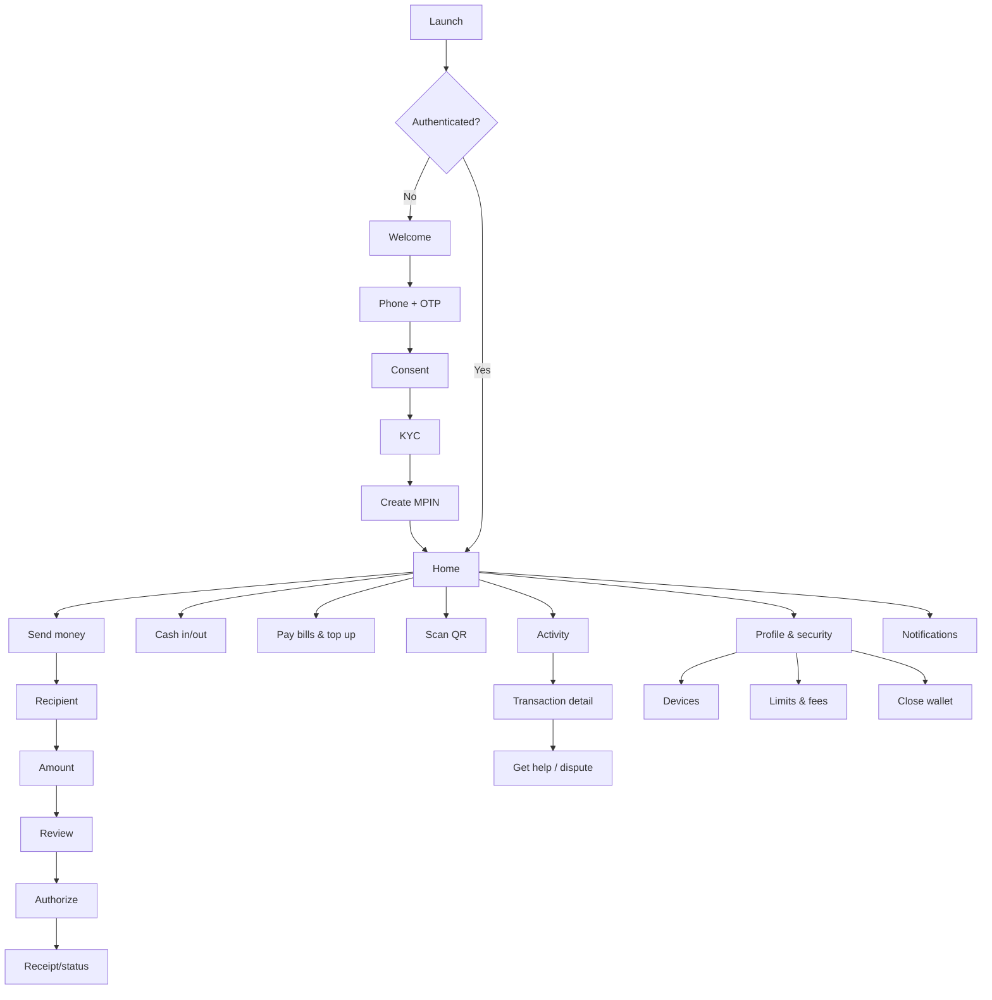
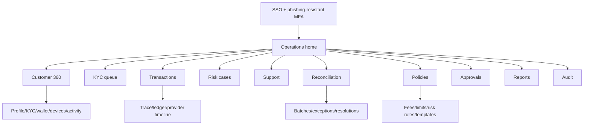
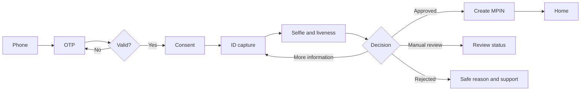
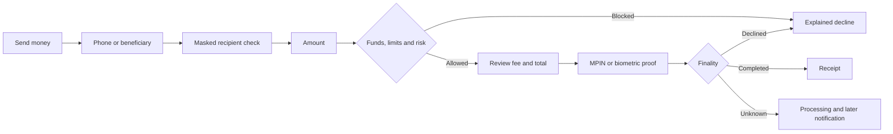
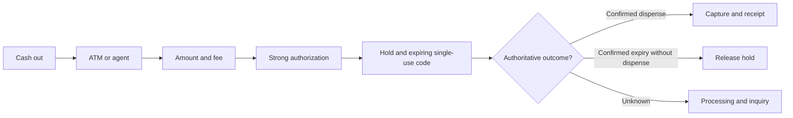
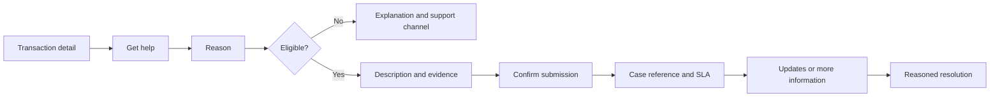
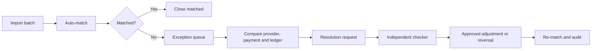
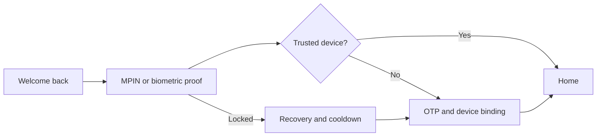
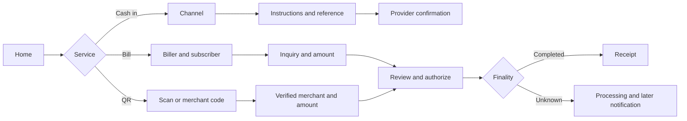
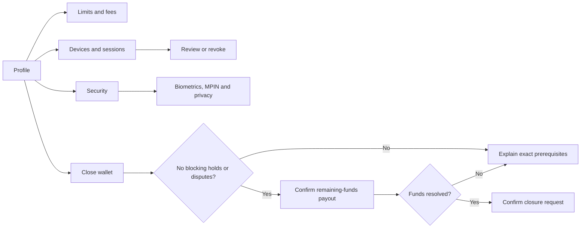

# DONECASH — UX and UI Design

English handover edition · [Interactive prototype](../prototype/index.html) · [Screenshot gallery](../design/README.md).

## 1. Experience direction

Combine the clarity expected of a financial product with the supplied expressive brand: Paper Cream `#f2f2f2`, white surfaces, black 1px borders and Pink/Cyan/Lime/Khaki panels. Saturated colors identify spaces and moments; status also needs explicit text and a meaningful icon/shape.

### UX principles

1. Trust before speed: masked recipient, fees and total before confirmation.
2. One understandable status: timeout is processing, with a next-step explanation.
3. Safe correction: separate review, new-beneficiary warning and cancellation only before execution allows it.
4. Available funds first: explain holds and limits separately from the posted balance.
5. English first, LTR: future Arabic uses true RTL without reversing phone numbers/references.
6. Accessibility is part of the product: assistive technology, scalable text, 48dp targets and non-color cues.

## 2. Product sitemaps

### Customer application

### Operations backoffice

## 3. Full page inventory

The prototype includes 36 mobile routes (M-01–M-34 plus M-18A/M-19A) and 22 operations routes. Required states below are implementation/design acceptance requirements; route coverage does not mean every state is interactively implemented.

### Mobile

| ID | Screen | Purpose / primary action | Required states |
|---|---|---|---|
| M-01 | Secure launch | Version/security check; continue | Offline, maintenance, forced update |
| M-02 | Welcome | Explain value; get started | Returning user |
| M-03 | Phone | Enter eligible number; send code | Invalid, rate-limited |
| M-04 | OTP | Verify ownership | Wrong, expired, resend timer |
| M-05 | Consent | Required terms and optional marketing | Version, separate consent |
| M-06 | Identity guide | Prepare ID/selfie; start capture | Permission denied |
| M-07 | ID capture | Front/back evidence; use photo | Blur, glare, crop, retry |
| M-08 | Selfie/liveness | Verify presence | Retry, accessible/manual review |
| M-09 | KYC status | Explain review; supply information | Pending, more information, rejected |
| M-10 | Create MPIN | Create/confirm secure PIN | Weak sequence, mismatch |
| M-11 | Login | MPIN/device biometric | Locked, recovery, new device |
| M-12 | Home | Available funds and shortcuts | Hidden balance, holds, restricted |
| M-13 | Recipient | Phone/saved beneficiary | Not found, self-transfer, blocked |
| M-14 | Amount | Amount/note; review | Insufficient funds, above limit |
| M-15 | Transfer review | Recipient, fee and total | Expired quote |
| M-16 | Authorization | MPIN/biometric proof | Failed proof, step-up |
| M-17 | Receipt | Result and public reference | Completed, processing, failed |
| M-18 | Cash in | Choose available channel | Channel unavailable |
| M-18A | Cash-in instructions | ATM/agent steps and reference | Expired, unavailable, provider pending |
| M-19 | Cash out | Amount/channel; create code | Expired, used, cancelled |
| M-19A | Cash-out code | Code, TTL and instructions | Consumed, expired, cancelled, pending |
| M-20 | Bills/top-up categories | Choose service/biller | Empty, unavailable |
| M-21 | Bill inquiry | Subscriber, due amount and fee | Not found, paid already, stale inquiry |
| M-22 | QR scanner | Read merchant payload | Permission, invalid, expired |
| M-23 | Merchant review | Merchant/branch/amount; authorize | Static editable vs dynamic locked |
| M-24 | Activity | Filter history; open transaction | Loading, empty, filtered |
| M-25 | Transaction detail | Timeline, fees and reference | Processing, reversed |
| M-26 | New dispute | Reason, description and evidence | Duplicate, ineligible |
| M-27 | Dispute detail | SLA/status/messages | Waiting for customer, closed |
| M-28 | Notifications | Financial/security event inbox | Read, unread |
| M-29 | Profile | Identity and account settings | Restricted account |
| M-30 | Limits and fees | Usage, remaining and policy | Effective dates and timezone |
| M-31 | Devices | Review/revoke sessions | Current, new, risky |
| M-32 | Security | MPIN, biometrics and privacy | Cooldown, recovery |
| M-33 | Help | FAQ, contact and service status | Provider outage |
| M-34 | Close wallet | Prerequisites, payout and request | Nonzero funds, active holds/dispute |

### Backoffice

| ID | Page | Audience | Core task |
|---|---|---|---|
| O-01 | Operations home | All scoped roles | Queues, operational SLOs and actionable exposure |
| O-02 | Customer search | Support/compliance | Exact search with access reason |
| O-03 | Customer 360 | Support/compliance | Masked profile/KYC/wallet/devices/activity |
| O-04 | KYC queue | KYC analyst | Priority, SLA and assignment |
| O-05 | KYC review | KYC analyst | Evidence, screening and reason-coded decision |
| O-06 | Transaction search | Operations/finance | Filters and provider/public references |
| O-07 | Transaction trace | Operations/finance | State, ledger, webhook and outbox evidence |
| O-08 | Risk alerts | Fraud | Queue and rule evidence |
| O-09 | Risk case | Fraud | Linked entities and controlled containment |
| O-10 | Support queue | Support | Priority, SLA and channel |
| O-11 | Ticket workspace | Support | Context, messages and safe escalation |
| O-12 | Reconciliation batches | Finance | Imports, status and totals |
| O-13 | Reconciliation exceptions | Finance | Compare external/internal and request resolution |
| O-14 | Fee policies | Product/finance | Version, preview and scheduling |
| O-15 | Limit policies | Compliance/product | Scope, version and effective dates |
| O-16 | Risk rules | Fraud | Draft, test and activate |
| O-17 | Approvals inbox | Checker | Evidence, diff and approve/reject |
| O-18 | Staff and roles | IAM administration | RBAC, expiry and segregation of duties |
| O-19 | Audit explorer | Auditor | Actor/resource/time and controlled export |
| O-20 | Reports | Management/regulatory | Scheduled controlled reports |
| O-21 | Provider health | SRE/operations | Latency, errors and circuit status |
| O-22 | Notification templates | Operations/product | English and future Arabic versions/preview |

## 4. Navigation model

Mobile bottom navigation: Home, Activity, Scan and Profile. Sending, bills and cash are tasks launched from Home rather than extra tabs. QR retains a visible label. Backoffice uses a role-aware sidebar; hiding links is not authorization—direct URLs require server-side permission checks.

## 5. User flows

### Registration and KYC

### Sending money

### Cash withdrawal

Unknown dispense must not release funds blindly merely because a local timer expired.

### Transaction dispute

### Reconciliation exception

### Login and recovery

### Deposits, bills and QR

### Account, security and closure

### Operations flow coverage

| Flow | Start to finish | Page IDs |
|---|---|---|
| Customer support | Reasoned search → Customer 360 → transaction → ticket → response/escalation | O-02,03,06,07,10,11 |
| KYC | Queue → evidence/screening → reason → decision → audit | O-04,05,19 |
| Fraud | Alert → linked case → notes → approved containment → audit | O-08,09,17,19 |
| Transaction operations | Search → API/ledger/provider/outbox trace → safe action | O-06,07,21 |
| Reconciliation | Batch → exception → compare → request → checker → re-match | O-12,13,17,19 |
| Policy lifecycle | Draft fee/limit/rule/template → preview → approval → effective activation | O-14,15,16,17,22 |
| IAM | Role assignment → SoD check → expiry/review → approval → audit | O-18,17,19 |
| Oversight | Overview → provider health → report → controlled export | O-01,21,20,19 |

## 6. Wireframes

[English low-fidelity board](../design/wireframes.html) and its PNG cover Home → Recipient → Amount → Review → Receipt, plus Customer 360 and Transaction Trace. They are retained SDLC artifacts, not an alternative final UI. The complete screen inventory is represented by the higher-fidelity prototype, not by this intentionally limited wireframe board. A separate KYC wireframe is not evidenced by the original board.

Reference mobile canvas 390×844; safe areas; 20px horizontal product padding; 10/16/24 rhythm; 48px controls; explicit back direction; financial review on a full page rather than a sheet hiding fees. Use skeleton content and contextual progress, not unexplained spinners.

## 7. UI specification

| Element | Direction |
|---|---|
| Canvas | Paper Cream `#f2f2f2` |
| Surface | White or Graphite for deliberate inverted panels |
| Structural ink | Black, 1px border |
| Main action | Toxic Lime with black text |
| Accents | Pink/Cyan/Khaki full surfaces, not small low-contrast colored text |
| Radius | 16px baseline controls/cards; 38–46px hero/frame reference |
| Display font | Licensed Helvetica condensed or approved substitute for short headings |
| Product text | Inter/system UI fallback; readable customer names and transaction labels |
| Numbers | Explicit currency and tabular, direction-isolated references |
| Elevation | Borders/offset decoration; no conventional drop shadows |

Keep confirmation screens visually calm: cream/white, black boundaries and Lime CTA. Do not tilt financial amounts. Completed uses explicit success text; processing uses explicit non-final messaging. The prototype contains compact text and radii that need further token/accessibility alignment; [the audit](06-design-system-audit.md) documents this honestly.

## 8. English content design

| Situation | Recommended copy | Avoid |
|---|---|---|
| Transfer CTA | “Review transfer”, then “Confirm and send” | Submit / OK |
| Recipient | “You’re sending to Mohamed A.” | Unnecessary full identity disclosure |
| Fee | “Transfer fee: 5.00 EGP” | Fee hidden in a tooltip |
| Pending | “Your request is processing. Do not send again.” | Generic error |
| Confirmed no-debit failure | “The transfer was not completed. Your balance was not debited.” | Claiming no debit when outcome is unknown |
| Limit | “12,500 EGP remaining today” | Bare technical error code |
| Risk review | “We need to review this transaction to protect your account.” | Rule disclosure or accusation |

## 9. Component inventory

Mobile: app bar, balance/hold card, service tile, transaction row, keypad, recipient block, fee breakdown, banner, receipt, timeline, usage meter, OTP/PIN, capture/scanner overlays, empty/error/offline states and clear primary/secondary/destructive controls.

Backoffice: scoped sidebar, exact-search bar, queues/filters/SLA, masked/reveal-with-reason field, evidence viewer, split workspace, trace/ledger table, policy diff, approval panel and audit row. Restrict bulk changes; never offer uncontrolled bulk financial mutation.

## 10. State matrix

For each important screen: default, loading, empty, validation error, business decline, offline, timeout/processing, restricted access and large text. Financial flows add duplicate submission, stale quote, provider unavailable and reversal. These are acceptance requirements for subsequent implementation; the current prototype is predominantly a default-state navigation representation.

## 11. Accessibility and platform review

- AA text contrast, visible focus, logical assistive reading order and descriptive functional labels.
- 48×48dp touch targets with separation where practical.
- Balance privacy control, rather than unexpectedly reading sensitive money aloud.
- Decorative art hidden from assistive technology; no status communicated by color alone.
- 200% text without losing merchant, amount or CTA.
- OTP supports paste/autofill and a stable accessible alternative.
- Optional haptics/audio with equivalent visible feedback and reduced motion.
- Test VoiceOver, TalkBack, keyboard web and later mixed-direction Arabic references.

| Dimension | iOS | Android |
|---|---|---|
| Insets | Notch/Dynamic Island and home indicator | Status bar, gestures/navigation and edge-to-edge |
| Scaling | Dynamic Type through target 200% | Font/display scaling through target 200% |
| Accessibility | VoiceOver, Reduce Motion, Increase Contrast | TalkBack, Remove Animations, contrast settings |
| Storage | Keychain/Secure Enclave | Keystore/StrongBox where available |
| Biometrics | LocalAuthentication | BiometricPrompt |
| Integrity | App Attest with fallback | Play Integrity verified server-side |
| Links | Universal Links | Verified Android App Links |

The visual switch in the prototype illustrates platform shells. It does not substitute for native devices, simulators, secure-storage implementation or accessibility certification.

## 12. Test and approval plan

Design critique with product/engineering/finance/compliance/support; five-second trust test; two moderated rounds of five users each for KYC/P2P/disputes; weak-network/duplicate/wrong-OTP/recovery tests; contrast/keyboard/assistive-technology review; recorded screen/state/copy/rule/criteria approval with date and owner.

Proposed sign-off targets: ≥80% unaided critical-flow completion, no wrong-recipient submission in the scripted scenario, ≥90% correct pending comprehension, fees/total before every authorization, no Critical accessibility issue and no High issue without accepted remediation. These are targets, not recorded test results.

## 13. Presentation sources

`prototype/` is the interactive source. `design/final/` holds derived presentation images and a route manifest. English wireframes are in `design/`. Supplied originals remain under `Assets/` and `Design System/`. First incomplete UI previews are not part of this delivery.

## Sources

1. Android Accessibility Help, [Touch Target Size](https://support.google.com/accessibility/android/answer/7101858), accessed 13 September 2026.
2. NTRA, [Instructions for Mobile Wallet Accessibility](https://www.tra.gov.eg/en/ntra-issues-instructions-to-facilitate-the-use-of-mobile-e-wallet-services-for-people-of-determination/), 4 December 2024.
3. NTRA, [Mobile Wallet Services](https://www.tra.gov.eg/en/regulations/consumer-manuals-and-tips/mobile-wallet-services/), accessed 13 September 2026.
4. Orange Egypt, [Orange Cash E-Wallet](https://www.orange.eg/en/services/Orange-financial-services), accessed 13 September 2026.
5. e& Egypt, [e& money](https://www.eand.com.eg/portal/pages/services/eand_money_en.html), accessed 13 September 2026.

