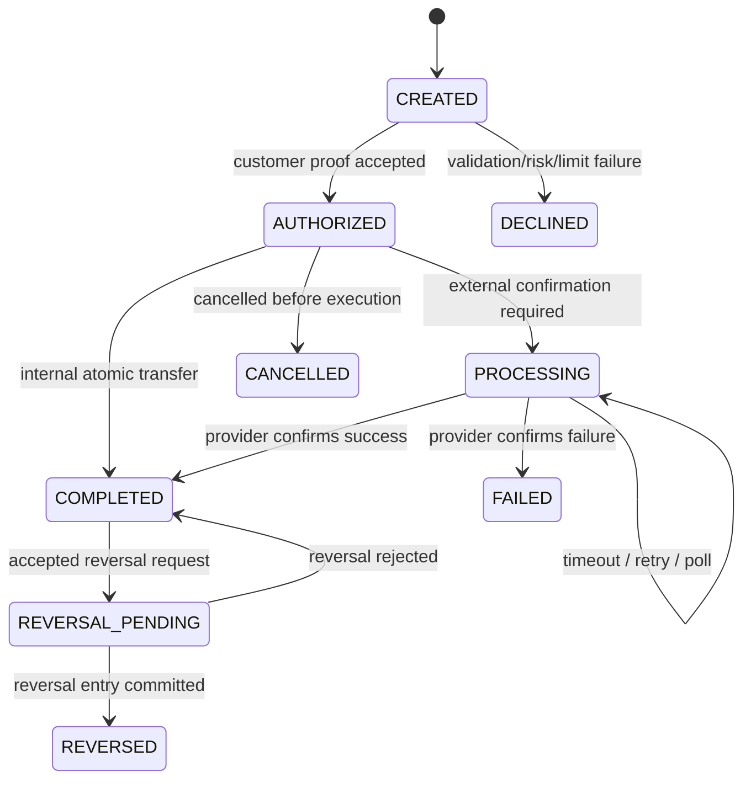

# DONECASH — Business Logic Specification

English handover edition · This specification defines intended behavior and future automated acceptance tests. It does not describe an already implemented financial engine. Original research references retain their September 2026 access dates.

## 1. Purpose and Scope

This document defines the executable business behavior of DONECASH across the customer mobile application, merchant and agent capabilities, payment orchestration, ledger, risk and compliance, support, reconciliation, notifications, and the internal operations platform.

It sits between product requirements and implementation. Every rule must be implemented in one authoritative domain module, exposed through use cases rather than duplicated in controllers or UI code, and covered by automated tests.

### Core invariants

1. A financial transaction is never considered completed before a balanced ledger entry is committed.
2. A posted ledger entry is immutable; correction happens through a linked reversal or adjustment.
3. The same authorized request cannot move money twice.
4. Available balance cannot become negative unless an explicit overdraft product exists; none exists in the MVP.
5. A timeout is not a failure. Unknown external outcomes remain `PROCESSING` until reconciled.
6. Limits, fees and risk decisions use the policy version effective at authorization time.
7. Privileged operational actions require a reason, an audit event, and maker-checker approval where configured.
8. Customer-facing status and internal accounting status remain distinguishable but traceable.

## 2. Domain Vocabulary

| Term | Meaning |
|---|---|
| Customer | Verified or prospective natural person using the wallet |
| Wallet | Customer-facing store of value and lifecycle state |
| Ledger account | Accounting account representing a wallet, clearing account, fee account or platform account |
| Payment transaction | Business command and lifecycle visible to customer/operations |
| Journal entry | Balanced accounting event containing at least two postings |
| Posting | Immutable debit or credit against one ledger account |
| Hold | Temporary reservation reducing available balance without final settlement |
| Quote | Short-lived calculation of amount, fees, limits and recipient/merchant context |
| Provider | External bank, switch, biller, KYC, SMS or cash network |
| Reversal | New journal entry economically cancelling an earlier entry |
| Adjustment | Controlled accounting entry resolving a verified difference |
| Reconciliation break | Difference between provider evidence and internal state |
| Policy | Versioned business rule with scope and effective dates |
| Maker-checker | Separation requiring a second authorized person to approve a sensitive action |

## 3. Aggregate Boundaries and Ownership

| Aggregate | Owns | May reference | Must not do |
|---|---|---|---|
| Customer | profile, status, primary contact | KYC case, devices | write ledger |
| KYC Case | documents, screening, decision | customer, staff decision | activate wallet directly |
| Wallet | lifecycle, restrictions, holds | customer, ledger account | store authoritative balance |
| Payment Transaction | state, quote snapshot, provider references | wallet, journal entry | mutate postings |
| Journal Entry | postings, reversal link | transaction | accept unbalanced commit |
| Risk Case | alerts, decision, restrictions | customer, transactions | post money |
| Reconciliation Batch | items, resolution state | transactions, provider file | edit provider evidence |
| Approval Request | proposed action, maker/checker, decision | resource | allow maker = checker |

## 4. Customer and Eligibility Rules

### BR-CUS-001 — Unique identity

- National ID uniqueness is checked using a keyed deterministic hash, never by logging or exposing the plaintext ID.
- A duplicate identity does not reveal the existing account. The response directs the customer to secure recovery.
- One mobile number may have only one active wallet relationship at a time.

### BR-CUS-002 — Eligibility

For the Egyptian MVP, the customer must:

- provide an eligible Egyptian mobile number;
- pass phone ownership verification;
- provide a valid national ID and required consents;
- pass the configured KYC/screening level;
- not be classified as prohibited or under an unresolved blocking decision.

Published CBE/NTRA material states one active wallet per phone and up to three wallets per national ID; the final production rule must come from the effective sponsor/regulatory policy.^1

### BR-CUS-003 — Customer status

```text
PENDING_KYC → ACTIVE → RESTRICTED → ACTIVE
                    ↘ SUSPENDED → ACTIVE | CLOSED
PENDING_KYC → CLOSED
```

- `RESTRICTED`: login and read access may remain; selected financial operations are blocked.
- `SUSPENDED`: all money movement blocked except controlled refund/closure processes.
- `CLOSED`: no new transactions; retention and balance-return workflow remains.

## 5. Onboarding and KYC Logic

### Onboarding flow

1. Normalize mobile number to E.164 and apply enumeration-safe eligibility check.
2. Create OTP challenge with purpose, TTL, attempt limit and device context.
3. Verify OTP atomically; successful challenge can be consumed once.
4. Record mandatory consent document versions and optional marketing consent separately.
5. Create KYC case and pre-signed upload references.
6. Validate document type, file integrity, malware result, OCR fields and liveness result.
7. Run sanctions/PEP/adverse screening through a provider adapter.
8. Auto-approve only when every required control passes and no manual-review rule fires.
9. On approval, create customer wallet and ledger account inside one transaction.
10. Require MPIN setup and device trust before first money movement.

### KYC decisions

| Condition | Decision | Customer message |
|---|---|---|
| All checks clear | `APPROVED` | Wallet ready |
| Image/OCR incomplete | `MORE_INFO_REQUIRED` | Retake or provide missing information |
| Potential screening match | `IN_REVIEW` | Review in progress; no accusation |
| Confirmed ineligibility | `REJECTED` | Unable to open wallet; support path |
| ID expired during review | `EXPIRED` | Provide a valid ID |

Every non-approval decision records a reason code. Free text is supplemental and never drives automated behavior.

## 6. Authentication and Device Trust

### MPIN

- Minimum six digits and weak/repeated/sequential patterns rejected.
- Store only a slow KDF hash with per-user salt and server-side pepper protected by KMS/HSM.
- Five consecutive failures trigger policy-based cooldown and risk signal; higher risk may suspend authentication.
- MPIN reset invalidates existing refresh tokens and requires phone verification plus step-up/device review.

### Sessions

- Access token short-lived; refresh token rotated on every use.
- Reuse of an old refresh token revokes the token family and opens a risk alert.
- A new device starts `PENDING`; financial operations may have a cooling period or lower limits.
- Biometric authentication unlocks a device-held key; biometric templates never reach DONECASH.

### Step-up triggers

- new/untrusted device;
- unusual velocity or location change;
- first beneficiary or high-value transaction;
- MPIN reset within the configured risk window;
- privileged staff action or sensitive data reveal.

## 7. Balance Logic

### Calculations

For a wallet liability account whose normal side is credit:

```text
ledgerBalance = totalCredits - totalDebits
activeHolds   = sum(ACTIVE hold amounts)
availableBalance = ledgerBalance - activeHolds
```

The API may serve a cached balance read model, but authorization revalidates against authoritative postings and active holds in the same database transaction.

### Balance rules

- Holds cannot exceed currently available balance.
- Capturing a hold posts the final journal entry and marks the hold `CAPTURED` atomically.
- Releasing/expiring a hold does not create a posting unless the product’s accounting policy explicitly requires one.
- A wallet restriction does not change balance; it changes allowed operations.

## 8. Fee Logic

### Fee selection

Fee policy is selected by:

```text
transaction type + customer segment + channel + provider + effective timestamp
```

Most specific eligible policy wins. Equal-specificity active policies are a configuration error and block publication.

### Calculations

```text
FLAT       = flatMinor
PERCENTAGE = roundHalfUp(amountMinor × percentageBps / 10,000)
TIERED     = policy-defined bracket calculation
baseFee    = selected FLAT, PERCENTAGE or TIERED calculation
finalFee   = clamp(baseFee, minMinor, maxMinor)
totalDebit = amountMinor + finalFee
```

`clamp` applies the configured minimum and optional maximum; missing bounds do not create an artificial zero cap. Percentage arithmetic must use integer-safe multiplication/division and explicit half-up rounding. Validate that configured maximum is not below minimum.

- `quote` stores policy code/version, inputs, calculated fee, total debit and expiry.
- Authorization rejects an expired quote and returns a fresh quote; it never silently changes the fee.
- Promotions create an explicit discount component and funding account rather than editing fee revenue after posting.

## 9. Limit Logic

### Applicable limits

- per transaction;
- daily amount/count;
- monthly amount/count;
- rolling risk window;
- wallet balance ceiling;
- cash-out channel limit;
- new-wallet or new-device lower limits.

### Evaluation

1. Resolve effective policies for customer segment, KYC level, transaction type and channel.
2. Lock the relevant consumption records or evaluate inside a serializable transaction.
3. Calculate `projectedConsumption = currentConsumption + requestedAmount`.
4. Reject before financial posting if any hard limit fails.
5. Store policy versions and consumption window on the transaction decision.
6. Increment consumption only when the policy-defined stage is reached; release it on a qualifying cancellation/reversal.

Limits remain configuration data because published sources and operator pages can reflect different effective values at different times.^1 ^2

## 10. Recipient Resolution and Beneficiaries

- Normalize phone input and reject the customer’s own wallet.
- Apply enumeration protection: exact input, rate limits, generic responses, risk monitoring.
- Return only a masked display name after eligibility checks.
- First transfer to a recipient shows a stronger warning and may require step-up.
- Saving a beneficiary requires recent authentication and records alias, destination and creation context.
- Blocking a beneficiary affects the customer’s shortcut only; it does not block the recipient system-wide.

## 11. P2P Transfer Logic

### Preconditions

- source and destination wallets exist and are eligible;
- source wallet allows outgoing P2P; destination allows incoming P2P;
- amount is positive and currency is supported;
- quote is current and bound to the same source, recipient and amount;
- available balance covers amount + fee;
- limits and risk decision allow execution;
- authorization proof is valid and transaction-bound.

### Atomic posting

Example: send EGP 375.00 with EGP 5.00 fee.

| Account | Direction | Amount |
|---|---|---:|
| Sender wallet liability | Debit | 380.00 |
| Receiver wallet liability | Credit | 375.00 |
| Transfer fee revenue | Credit | 5.00 |

Within one database transaction:

1. reserve idempotency key;
2. lock source account/limit consumption;
3. revalidate balance, policy and risk decision freshness;
4. create payment transaction;
5. create balanced journal entry and postings;
6. update limit consumption;
7. write outbox events;
8. commit;
9. notify both parties asynchronously.

### Idempotency behavior

| Request condition | Response |
|---|---|
| First valid key | Execute once and persist response fingerprint |
| Same key + same payload | Return original outcome |
| Same key + different payload | `409 IDEMPOTENCY_KEY_REUSED` |
| Client timeout after commit | Retry returns original completed transaction |

## 12. Cash-in Logic

### Agent/branch/ATM

- Create intent with amount, channel, expiry and customer identity context.
- External provider confirmation must contain unique reference and verified signature.
- Duplicate confirmations are ignored idempotently.
- Posting credits the customer wallet liability and debits the appropriate cash/provider clearing account.
- Cash-in marked `COMPLETED` only after confirmed provider evidence or a sponsor-approved finality rule.

### Card-to-wallet

- Use tokenized provider flows; DONECASH must not store PAN/CVV.
- Funding card ownership/name matching and velocity controls apply.
- Chargeback risk may create a temporary hold or delayed availability by policy.

## 13. Cash-out Logic

1. Validate wallet, balance, limits, risk and channel availability.
2. Create quote and transaction-bound authorization.
3. Create active hold for amount + fee.
4. Generate a single-use withdrawal code, store only its hash and bind it to channel, amount and expiry.
5. On provider success, capture the hold and post wallet debit, provider clearing credit and fee credit.
6. On verified rejection or confirmed expiry without dispense, release the hold. Local code expiry alone must not release a withdrawal whose provider outcome is unknown.
7. On timeout, retain `PROCESSING` until polling/webhook/reconciliation resolves the external outcome.

## 14. Bill Payment and Top-up Logic

### Inquiry

- Inquiry is read-only and receives a provider reference plus expiry.
- The displayed biller name, subscriber reference mask, amount and fees are snapshotted in the quote.
- A stale inquiry must be refreshed before payment.

### Payment

- Prevent duplicates using wallet + biller + bill reference + configured period.
- Create hold/authorization before calling provider when finality is asynchronous.
- Provider accepted-but-unknown remains `PROCESSING`.
- A confirmed failure releases the hold. A confirmed success captures it.
- Reconciliation can resolve unknown items but cannot overwrite provider evidence.

## 15. Merchant QR Payment Logic

### QR validation

- Verify signature/checksum, merchant status, QR status, currency and expiry.
- Static QR allows customer-entered amount; dynamic QR binds amount and merchant order reference.
- Used dynamic QR cannot be replayed.
- Display merchant name, branch, amount and fee before authorization.

### Posting

- Debit customer wallet for amount + customer fee, if any.
- Credit merchant payable/settlement account for net or gross amount according to contract.
- Credit fee revenue and/or merchant fee receivable explicitly.
- Settlement to merchant bank is a separate transaction and reconciliation process.

## 16. Transaction State Machine



Invalid state transitions return a domain conflict and create no side effect.

## 17. Reversal and Refund Logic

- Reversal eligibility depends on transaction type, finality, age, provider capability and dispute state.
- A completed P2P is not automatically reversible because the recipient may already use the funds.
- A reversal creates a new payment transaction and new journal entry linked to the original.
- Partial merchant refund stores cumulative refunded amount and rejects a total above the captured amount.
- Financial adjustment requires evidence, maker-checker approval and a specific adjustment account.
- Customer notifications explain economic result, not internal ledger terminology.

## 18. Risk and Fraud Logic

### Decision inputs

- customer/KYC risk tier;
- device trust, app integrity and recent enrollment/reset;
- amount, frequency, recipient novelty and velocity;
- failed authentication attempts;
- IP/network/geolocation consistency where lawful;
- provider/channel health;
- historical disputes and confirmed fraud;
- sanctions/PEP or compliance restrictions.

### Decision outputs

| Action | Effect |
|---|---|
| `ALLOW` | Continue |
| `CHALLENGE` | Require step-up and re-evaluate |
| `HOLD` | Prevent or reserve value pending review |
| `DECLINE` | Stop without posting |
| `REVIEW` | Create alert/case; synchronous policy decides whether to pause |

- Each alert stores rule code/version, evidence snapshot and score.
- Customer text never exposes fraud thresholds or accusations.
- Rule publication requires test cases against historical/synthetic data and checker approval.

## 19. Dispute and Support Logic

### Dispute eligibility

- transaction belongs to customer;
- transaction type/reason combination is supported;
- transaction is within the configured dispute window;
- no duplicate open dispute for transaction + reason;
- required evidence is present.

### Workflow

`OPEN → IN_REVIEW → WAITING_CUSTOMER → IN_REVIEW → ACCEPTED | REJECTED → CLOSED`

- Opening a dispute does not move money automatically.
- SLA uses business-calendar policy and pauses only in explicitly allowed states.
- Staff messages are separated into customer-visible and internal notes.
- Any accepted financial remedy calls the controlled refund/reversal use case.

## 20. Reconciliation Logic

### Import

- Verify file/provider identity, expected business date, schema, totals and SHA-256.
- Same provider/date/hash is idempotent.
- Preserve original file in immutable storage; parsed rows remain linked to source line.

### Matching priority

1. exact provider reference;
2. internal reference carried by provider;
3. approved composite match: amount + masked participant + bounded timestamp;
4. otherwise manual exception.

### Exception classification

- `NOT_FOUND_INTERNAL`;
- `NOT_FOUND_EXTERNAL`;
- `AMOUNT_MISMATCH`;
- `STATUS_MISMATCH`;
- `DUPLICATE`.

Resolution never edits the imported evidence or historical transaction. It may update operational status, request provider action, or create an approved adjustment/reversal.

## 21. Notifications Logic

- Financial notifications derive from committed outbox events, never from client success screens.
- Template version, locale and masked destination are stored.
- Push failure may fall back to SMS for mandatory financial/security events.
- Notification retries are idempotent by event + template + channel.
- Optional marketing consent cannot suppress mandatory security or transaction notices.
- A delivery failure does not roll back a completed financial transaction.

## 22. Policy Lifecycle

```text
DRAFT → REVIEWED → SCHEDULED → ACTIVE → RETIRED
```

- Draft can be edited by maker.
- Review runs validation, overlap detection and scenario simulation.
- Checker cannot be maker.
- Scheduled policy has future `effective_from` and cannot be silently edited; create a new version.
- At most one equally specific active version may match a request.
- Every decision persists policy identifiers for later explanation.

## 23. Backoffice Authorization Logic

| Capability | Minimum controls |
|---|---|
| Customer search | exact identifier + reason-for-access + audit |
| Reveal sensitive data | separate permission + reason + watermark + audit |
| KYC decision | assigned role; high-risk decision may require checker |
| Wallet restriction | reason; high-impact action requires checker |
| Ledger view | finance/audit read-only |
| Adjustment/reversal | maker-checker; no direct table write |
| Policy activation | maker-checker + simulation evidence |
| Export | scoped permission + approval for sensitive bulk data + expiring file |
| Role assignment | IAM admin + expiry + SoD validation |

## 24. Audit Logic

Audit events are append-only and include:

- actor type/id, role and session;
- action and resource type/id;
- timestamp, IP/device and correlation ID;
- reason code and approval request where applicable;
- before/after diff with sensitive values masked;
- outcome and failure code.

Sensitive reads are auditable, not only writes. Audit export is copied to immutable/WORM storage and monitored for continuity.

## 25. Provider Integration Logic

- Each provider implements a canonical adapter interface: `quote/inquire`, `execute`, `getStatus`, `cancel` where supported, and webhook verification.
- Circuit breakers stop new calls when failure thresholds are exceeded; they do not guess outcomes for in-flight transactions.
- Retry only operations declared safe or protected by provider idempotency.
- Webhook inbox deduplicates message IDs/signatures before business processing.
- Out-of-order events are rejected or reconciled using provider sequence/finality rules.

## 26. Failure and Recovery Matrix

| Failure | Customer state | System action |
|---|---|---|
| Client disconnect before request reaches API | No transaction | Safe retry with same key |
| Client timeout after internal commit | Completed, possibly unseen | Retry returns original response |
| Provider timeout before known acceptance | Processing | Poll and reconcile; do not retry unsafe call blindly |
| Database serialization conflict | No commit | bounded server retry with same command |
| Outbox worker down | Financial commit preserved | catch up and send notification later |
| Redis unavailable | Degraded controls | fail closed for auth/rate-critical paths; ledger unaffected |
| Biller unavailable | No new payment or Processing if accepted | surface provider status and preserve holds correctly |
| Reconciliation file malformed | Batch failed | no partial silent acceptance; report line/schema issue |

## 27. Domain Events

| Event | Producer | Primary consumers |
|---|---|---|
| `CustomerKycApproved` | KYC | Wallet provisioning, notification |
| `WalletActivated` | Wallet | Customer experience, analytics |
| `TransferCompleted` | Payments/Ledger | notifications, activity, risk monitoring |
| `TransactionProcessing` | Payments | polling, customer status |
| `TransactionReversed` | Ledger/Payments | notification, limits, reconciliation |
| `RiskAlertRaised` | Risk | case management, wallet controls |
| `DisputeOpened` | Support | SLA, notification, operations queue |
| `ReconciliationBreakDetected` | Reconciliation | finance queue, incident rules |
| `PolicyActivated` | Policy | cache invalidation, audit, decision engine |

Event payloads contain identifiers and necessary snapshots only; PII is fetched by an authorized consumer rather than broadcast.

## 28. Business Rule Traceability

| Rule group | Requirements | Main tables | Main tests |
|---|---|---|---|
| Eligibility/KYC | FR-001–003, FR-201–202 | customers, phones, kyc_* | duplicates, decision transitions, expiry |
| Wallet/balance | FR-004, NFR-003 | wallets, ledger_*, holds | balance properties, no negative available |
| P2P | FR-005–006 | transactions, transfers, postings | concurrency, idempotency, fee/limit versions |
| Cash | FR-007 | cash_operations, holds | expiry, duplicate webhook, unknown outcome |
| Bills/QR | FR-008–009 | bill_*, merchant_* | stale inquiry, replayed QR, pending resolution |
| Disputes | FR-011, FR-205 | disputes, tickets | eligibility, SLA, financial remedy separation |
| Risk | FR-203 | risk_* | rule versioning, challenge, hold approvals |
| Reconciliation | FR-206 | reconciliation_* | import idempotency, match classes, adjustments |
| Policies | FR-207 | fee_policies, limit_policies | overlaps, effective time, maker-checker |
| IAM/Audit | FR-208–209 | staff/roles/approvals/audit | SoD, reveal reason, append-only evidence |

## 29. Minimum Automated Test Catalogue

### Property and concurrency tests

- every posted journal entry balances to zero by currency;
- arbitrary transfer sequence preserves system-wide value excluding explicit fees/funding;
- N concurrent transfers cannot spend beyond available balance;
- reversal plus original has zero net economic effect for reversible components;
- retrying any command with the same idempotency key produces at most one economic event.

### Policy tests

- boundary values: zero, minimum, maximum, one unit below/above;
- midnight/month boundary in Africa/Cairo and UTC conversion;
- policy activation exactly at effective timestamp;
- conflicting policy publication is rejected;
- fee rounding and caps use integer arithmetic.

### State tests

- every allowed transition succeeds;
- every invalid transition creates no side effect;
- timeout never becomes failure without evidence;
- out-of-order webhook cannot regress final state;
- closed/restricted wallet behavior matches operation matrix.

## 30. Open Decisions Before Production

- Sponsoring bank/PSP model and exact finality rules.
- Effective regulatory limits and wallet balance ceilings.
- Provider-specific refund/reversal guarantees.
- KYC automation thresholds and manual review obligations.
- AML transaction monitoring scenarios and reporting workflow.
- Data retention, localization and incident reporting obligations.
- Chart of accounts approval and settlement calendar.

## Sources

1. National Telecom Regulatory Authority, [Mobile Wallet Regulatory Rules](https://www.tra.gov.eg/en/mobile-wallets-regulatory-rules/), accessed 13 September 2026.
2. Orange Egypt, [Orange Cash E-Wallet](https://www.orange.eg/en/services/Orange-financial-services), accessed 13 September 2026.
3. Central Bank of Egypt, [PSO and PSP Licensing Rules](https://www.cbe.org.eg/en/news-publications/news/2025/06/19/08/20/psos-and-psps-licensing-rules), 19 June 2025.
4. OWASP, [Mobile Application Security Verification Standard](https://mas.owasp.org/MASVS/), accessed 13 September 2026.
5. Prisma, [Transactions and Batch Queries](https://www.prisma.io/docs/orm/v6/prisma-client/queries/transactions), accessed 13 September 2026.
