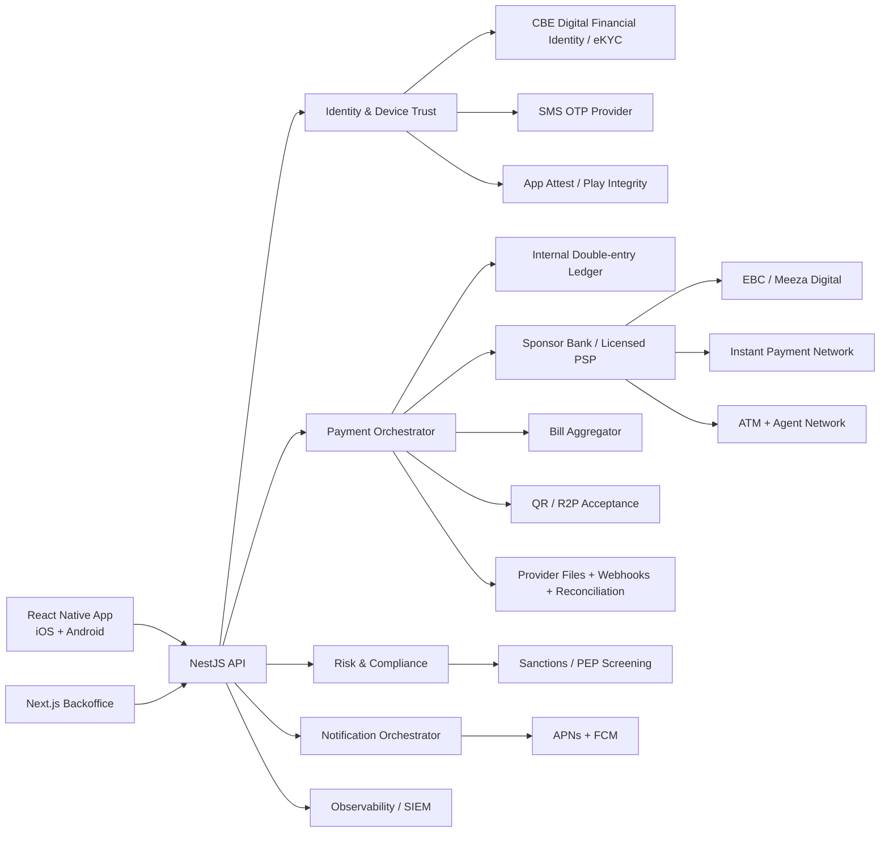

# DONECASH — External Integrations and Market-Readiness Plan

English handover edition · Original research snapshot: 13 September 2026. This is an integration plan, not evidence of commercial contracts, production access or legal approval.

## 1. Purpose

Identify what turns a portfolio wallet concept into an operable Egyptian financial product. Separate fully simulated portfolio behavior, vendor sandboxes and capabilities unavailable until an eligible licensed entity/sponsor, contracts and certification exist.

Keep each provider behind an internal port and independent adapter. Preserve protected request/response evidence, external reference, correlation identifier and reconciliation status. No vendor should dictate the domain's financial vocabulary.

## 2. Executive decision

An SMS API and KYC SDK alone do not authorize a wallet launch. Evaluate:

1. **Bank-sponsored model:** an eligible regulated bank/partner sponsors the service and provides approved rails, settlement and controls.
2. **Licensed-provider model:** operate through the appropriate licensed PSP/operating arrangements and contracted infrastructure, subject to applicable approvals.

The portfolio design proposes fake `SponsorBankAdapter` and `MeezaDigitalAdapter` implementations. Real-money launch still requires written legal/sponsor confirmation. The cited June 2025 CBE rules cover payment activities including cash services, transfers, issuance and acceptance; exact authorization depends on the entity and service scope.

## 3. Integration landscape



## 4. Priority matrix

| Integration | Purpose | Portfolio | Pilot | Production importance | Priority |
|---|---|---|---|---|---|
| Sponsor bank/licensed PSP | Legal operation, safeguarding and rail access | Mock | Contract/sandbox | Required | P0 |
| Meeza Digital | Wallet transfer, acceptance and wallet channels | Mock | Sponsor sandbox | Required for proposed rails | P0 |
| Identity/eKYC | Onboarding and identity updates | Fake SDK | Eligible certified sandbox | Required | P0 |
| Mobile ownership/SIM risk | Ownership and account-takeover controls | Mock | MNO/sponsor arrangement | Required control | P0 |
| SMS OTP | Phone verification/recovery/fallback | Test sink | Approved local route | Required | P0 |
| APNs/FCM | Financial/security notifications | Development credentials | Pilot credentials | Required | P0 |
| App Attest/Play Integrity | App/device risk signals | Test verdicts | Pilot | Required capability with fallback | P0 |
| Cash network | ATM/agent deposit and withdrawal | Simulator | Limited rail | Required | P0 |
| Reconciliation feeds | Settlement proof and discrepancies | Synthetic files | Daily files | Required | P0 |
| Bill aggregator | Utilities, telecom and services | Mock catalog | Sandbox | Competitive baseline | P1 |
| Merchant QR/R2P | Acceptance | Static mock | Sandbox | Competitive baseline | P1 |
| Account value load/IPN | Bank-account funding | Mock | Sponsor sandbox | High value | P1 |
| Sanctions/PEP/AML screening | Onboarding and ongoing review | Fake rules | Vendor sandbox | Required before real-money pilot under policy | P1 procurement, launch gate |
| Fraud intelligence | Device/velocity/linked risk | Internal simulation | Shadow mode | Required controls at scale | P1 |
| CRM/contact center | Complaint operations | Internal design | Optional connector | Optional vendor | P2 |
| Analytics/experimentation | Funnel/adoption | Local events | Privacy review | Optional | P2 |
| Incoming remittance | Convert eligible inbound funds to EGP | Outside MVP | Partner pilot | Differentiator | P2 |

Priority is sequencing, not permission to launch without AML/screening controls.

## 5. Core financial integrations

### 5.1 Sponsor bank or licensed partner

Agree who safeguards customer funds, owns settlement accounts, connects rails and assumes dispute/incident liability. Obtain approved product limits, pricing, settlement cycle, finality, KYC/AML responsibilities, consumer complaints and reporting obligations.

Required technical contract:

- Transport/protocol: REST, SOAP, ISO 8583 or files by channel.
- mTLS, allowlists, signing and HSM/key-ceremony requirements.
- External-reference uniqueness and retention.
- Status definitions and authoritative final states.
- Retry/inquiry semantics, maintenance and SLA.
- Webhook authentication and replay window.
- Business-day timezone, settlement/reconciliation file timing.
- Sandbox scenarios, UAT evidence and escalation contacts.

DONECASH's ledger is the internal accounting truth; sponsor/network records are reconciled against it. A discrepancy creates an exception, not a direct balance rewrite. Internal truth does not eliminate safeguarding or external settlement obligations.

### 5.2 EBC / Meeza Digital

The cited EBC materials describe Meeza Digital, IPN and shared cash infrastructure. Proposed integration capabilities are wallet-to-wallet transfer, privacy-preserving alias resolution, QR/R2P, approved account value load, cash messages, settlement positions and network reconciliation.

Do not assume a public developer API or direct participation rights. Access typically depends on sponsor/processor contracts and scheme eligibility. An adapter class does not establish access authorization.

### 5.3 IPN / bank-to-wallet funding

The cited CBE description allows eligible channels to transfer to accounts, Meeza cards and wallets. NTRA's Q2 2025 report attributed 65% of reported wallet funding sources to InstaPay bank transfers, motivating a sponsor-backed funding path.

Handle incoming-credit notifications, reference deduplication, permitted name/alias checks, reject/return mapping and daily reconciliation. Do not design the MVP as an unapproved direct DONECASH connection to IPN or as integration with a consumer application's private interface.

### 5.4 Cash-in and cash-out

Official wallet channels include provider branches, eligible agents and supporting cardless ATMs. Adapter capabilities:

1. Quote amount/fees/channel availability.
2. Create deposit reference or withdrawal code.
3. Bind authorization to amount/channel/customer.
4. Confirm deposit/dispense.
5. Cancel/expire safely and release eligible reservations.
6. Query unknown provider outcomes.
7. Ingest settlement files and ATM/agent exception reasons.

Codes are short-lived, single-use and absent from logs. Capture only after appropriate authoritative confirmation. A disconnect after dispense remains processing until inquiry/reconciliation; expiry cannot blindly release a potentially dispensed withdrawal. Support opens a case rather than edits money.

### 5.5 Bill aggregator

Procure a suitably eligible licensed aggregator/sponsor service after coverage, contract and technical evaluation. Original research named Fawry/e-finance as examples, not selected or contracted vendors.

Functional contract: list/version billers; validate subscriber; inquire amount/expiry/additional fields; pay valid quote; query pending payment; permitted refund/reversal; catalog and reconciliation feeds.

Evaluate utility/telecom/education/donation/government coverage, per-biller success/latency, inquiry validity, duplicate protection, refund semantics, exception SLA and transaction-level settlement matching. Aggregate success averages can hide a failing biller.

### 5.6 Merchant QR and Request to Pay

Validate merchant/terminal; support static QR with entered amount and dynamic QR with signed locked amount; return display name, branch, MCC and verification status; check expiry/nonce/signature; define void/refund finality, merchant fees and settlement.

The customer reviews merchant, amount and fees before authorization. Reading QR is not payment success; success requires authoritative execution and balanced accounting.

## 6. Identity, compliance and fraud

### 6.1 Digital financial identity/eKYC

The source research references the CBE framework updated in August 2026. Eligibility/access and permitted use need sponsor/compliance confirmation, rather than assuming a generic SDK connects to the framework.

Integration requirements: short-lived verification session; secure evidence capture/upload; OCR with independent authenticity checks; document authenticity, face match and liveness; separate rescreenable sanctions/PEP checks; reason-coded decisions and manual-review evidence; authenticated webhook with polling fallback; lawful retention/deletion controls.

Minimize raw media. Backoffice accesses encrypted object storage through short-lived signed, watermarked views with viewing audit. Verify vendor security claims, including actual encryption endpoints, rather than advertising unvalidated “end-to-end” encryption.

### 6.2 Mobile ownership and SIM signals

Ownership matching supports the proposed one-wallet-per-number rule. Seek contract-permitted ownership match, recent SIM swap, porting/recycled-number risk, line status and routing without unnecessary identity disclosure. Recent change may trigger cooldown/step-up/manual review, not permanent automated rejection.

### 6.3 Sanctions, PEP and adverse media

Original research named LSEG World-Check, LexisNexis, Dow Jones and ComplyAdvantage as RFP examples; no provider has been selected. Test Arabic/transliterated-name matching, local/international list coverage and freshness, provenance/explainability, rescreening, residency/DPA/retention, per-check cost and false-positive operations.

Provider output is evidence for internal compliance policy, not an unquestioned approve/reject boolean. Controls must be ready before the real-money pilot.

### 6.4 Device intelligence

Android Play Integrity verdicts are checked server-side. iOS App Attest supports legitimate-app/device-key assertions with fallback for unsupported devices. Bind a secure local key to server challenges, rotating after recovery. Attestation is one risk input alongside value, device age, SIM, recipient and velocity—not the sole fraud decision or a tracking identifier.

## 7. Customer communications

### SMS OTP

Evaluate approved local/MNO routes, sender registration, delivery receipts, English/Arabic Unicode, per-MNO metrics, controlled failover, phone/device/IP throttling, templates and fraud escalation. Do not use uncontrolled active-active sends that duplicate challenges. Store code hash, expiry and attempt counter, never cleartext OTP. Avoid unnecessary monetary/identity details in messages.

### Push

APNs for iOS and FCM for Android, with trusted-server credentials/OAuth where applicable. Push is a wake-up signal; authoritative status comes from the API. Financial/security notifications are separate from optional marketing preferences. Exclude sensitive balance/identity from payloads and lock-screen exposure. Provider acceptance/delivery is not proof of customer reading.

### Email and WhatsApp

Verified email can deliver non-urgent receipts/statements. WhatsApp Business is optional for consented, non-sensitive support/notifications using approved templates. Authentication and sensitive decisions stay on security-approved channels.

## 8. Platform readiness

| iOS | Android |
|---|---|
| APNs, App Attest, Keychain/Secure Enclave, LocalAuthentication | FCM, Play Integrity, Keystore, BiometricPrompt |
| Universal Links | Verified App Links |
| Privacy manifest and permission descriptions | Signing, obfuscation and secure network configuration |
| Dynamic Type, VoiceOver, reduced motion and safe areas | TalkBack, font scaling, gestures and edge-to-edge insets |

Biometrics unlock a local key; no fingerprint/face template is sent to DONECASH. Provide secure MPIN/recovery alternatives and unsupported-hardware fallback.

## 9. Optional card funding and tokenization

Use hosted/tokenized acquirer components, keeping PAN/CVV away from DONECASH servers. Agree 3-D Secure, PCI scope, token-reference storage, chargeback evidence and refund/reversal mapping. Tokens alone do not remove PCI obligations. The cited December 2024 CBE tokenization/Apple Pay announcement establishes market context, not DONECASH eligibility or a committed feature.

## 10. Future incoming international remittance

The original NTRA source described inbound remittance converted to EGP and attributed 7% of reported Q2 2025 funding sources to it. A future integration requires eligible remittance partner/bank settlement, sender/corridor screening, disclosed FX source/quote, transfer-purpose fields, name matching and AML case workflow. Post immutable EGP amounts while preserving source currency, amount and rate as reference evidence. Outside MVP.

## 11. Support, analytics and operations

### CRM/contact center

An internal support module can serve the MVP. Zendesk/Freshdesk/Salesforce were example options, not selected vendors. Any connector receives masked identifiers, not full KYC. Keep sensitive reveal inside DONECASH; synchronize tickets idempotently and coordinate retention/deletion across systems.

### Analytics

Privacy-review any PostHog/Amplitude/Mixpanel or other tool. Allowlist events/properties; exclude OTP, MPIN, national ID, full phone and balance. Separate pseudonymous analytics identity and appropriate optional consents. Financial conversions derive from committed backend events, not client tracking alone.

### Observability/SIEM

OpenTelemetry spans across API/queues/providers; metrics/SLO dashboards (for example Prometheus/Grafana or a reviewed hosted equivalent); scrubbed mobile crash reporting; audit/security-event SIEM. Track per-provider success, latency, pending exposure and reconciliation breaks. Vendor names are options, not evidence of existing services.

## 12. Canonical adapter contracts

```ts
export type ProviderResult<T> =
  | { kind: 'completed'; externalRef: string; data: T }
  | { kind: 'declined'; code: string; safeMessage: string }
  | { kind: 'processing'; externalRef?: string; retryAfterMs?: number };

export interface PaymentRailPort {
  quote(command: QuoteCommand): Promise<Quote>;
  execute(command: ExecuteCommand): Promise<ProviderResult<ExecutionData>>;
  inquire(externalRef: string): Promise<ProviderResult<ExecutionData>>;
  reverse(command: ReverseCommand): Promise<ProviderResult<ReversalData>>;
}

export interface IdentityVerificationPort {
  createSession(customerId: string): Promise<VerificationSession>;
  getDecision(providerCaseId: string): Promise<IdentityDecision>;
  requestDeletion(providerCaseId: string): Promise<void>;
}
```

These are illustrative interfaces, not compiled implementation files; referenced types need concrete definitions. Map provider statuses to domain vocabulary while retaining original protected evidence.

## 13. Webhook standard

1. mTLS where available and/or rotating HMAC/JWS per contract.
2. Unique provider event ID, timestamp and replay window.
3. Persist protected/redacted authenticated evidence before processing.
4. Acknowledge quickly; process through inbox workers.
5. Enforce `(provider, eventId)` uniqueness.
6. Never assume event order.
7. Inquire before declaring an unknown outcome failed.
8. Dead-letter handling, replay authorization and documented runbook.

```json
{
  "eventId": "evt_01J...",
  "eventType": "payment.status.changed",
  "occurredAt": "2026-09-13T10:42:19.122Z",
  "externalReference": "EXT-E-55218",
  "status": "SUCCESS",
  "amount": { "minor": 42050, "currency": "EGP" },
  "signatureVersion": "v2"
}
```

Verify webhook amount, currency, reference and authorized operation before applying financial effects.

## 14. Failure and reconciliation rules

| External situation | Internal outcome | Ledger action | Next action |
|---|---|---|---|
| Confirmed synchronous success | COMPLETED | Balanced posting/capture once | Receipt and notification |
| Confirmed decline | DECLINED | Release eligible reservation | Safe reason |
| Timeout/no response | PROCESSING | Hold/no final posting according to rail | Inquiry and reconciliation |
| Authoritative late success | COMPLETED | Capture once | Notify |
| Authoritative late failure | FAILED | Release eligible hold | Notify |
| Duplicate event | Unchanged | No repeat posting | Idempotent acknowledgement |
| Provider success without internal command | Reconciliation exception | No blind credit/debit | Finance investigation |
| Amount/currency mismatch | Reconciliation exception | Preserve evidence | Maker-checker resolution |
| Accepted final reversal | REVERSED | Linked reverse journal | Receipt and audit |

“Reconciliation exception” is an operations record, not a value in the current payment-status CHECK list. Conflicting late events require inquiry/guarded resolution rather than reversal of a known final outcome by timestamp alone.

## 15. Vendor security and data requirements

Before approval assess regulatory standing, subprocessors, residency/cross-border transfers, transit/storage encryption and keys, authenticated service credentials, tenant isolation, least privilege, appropriate independent security evidence, breach-notification SLA, cooperation, RTO/RPO/continuity tests, deletion/export/exit, audit access, uptime/latency/support terms and service credits.

Never put provider secrets in the mobile app or repository. Use a secrets manager, short-lived credentials where possible, rotation and tested revocation. Security certifications are evidence inputs, not replacements for product-specific assessment.

## 16. Vendor evaluation scorecard

| Dimension | Weight |
|---|---|
| Regulatory fit/licensing | 20% |
| Security/privacy/audit | 20% |
| Functional coverage | 15% |
| Per-use-case success/latency | 10% |
| Reconciliation/operations | 10% |
| API/sandbox/test evidence | 10% |
| Commercial model/unit economics | 8% |
| Support/SLA/incident response | 5% |
| Exit portability | 2% |

Regulatory or security gate failure disqualifies a vendor irrespective of weighted score.

## 17. Competitive roadmap

### Portfolio implementation

Provider simulators with success/decline/timeout/late webhook; synthetic KYC/manual review; SMS/mail sinks and mock push; reconciliation fixtures; attestation test interfaces; contract tests without real customer data. These are future implementation tasks, not delivered working adapters.

### Licensed MVP

Sponsor/eligible partner, proposed wallet rail, one cash rail, eKYC/ownership checks, local SMS/APNs/FCM, sanctions/PEP controls, daily reconciliation/runbooks and core bills. All regulated/compliance gates precede pilot.

### Competitive expansion

Approved bank funding, dynamic QR/R2P, agent/ATM locator and health, bill favorites/contract-permitted autopay, incoming remittance, merchant statements and explainable advanced fraud models.

## 18. Suggested NestJS layout

```text
src/integrations/
  sponsor-bank/
  meeza-digital/
  cash-network/
  bill-aggregator/
  identity-verification/
  mobile-ownership/
  screening/
  device-attestation/
  notifications/
  observability/
src/platform/
  provider-inbox/
  transactional-outbox/
  reconciliation/
  secrets/
  contract-testing/
```

Each integration needs a port, adapter, mapper, client, webhook controller, contract tests and fake adapter. Domain modules depend on ports. This is a proposed source layout, not an existing application tree.

## 19. Go-live exit criteria

- Written legal/contractual scope and approved operation.
- Partner-tested status/finality/reversal semantics.
- UAT: duplicates, timeout, out-of-order events and late success.
- Multi-business-day ledger/partner reconciliation evidence.
- Rotated production keys and tested revocation.
- No PII/secrets in logs, analytics or crash reports.
- On-call/runbooks/escalation tree and approved customer messaging.
- Successful restore/DR exercises.
- Independent security review with no unaccepted Critical/High findings.
- Trained support/compliance/finance operations and approved complaint process.

## 20. Open commercial decisions

Sponsor, revenue share and liability; safeguarding/settlement ownership; rail/agent/biller/funding fees; vendor minimum commitments; co-branding/channel rights; customer-data ownership/portability; exclusivity and adding a second rail. Obtain legal/finance/compliance decisions rather than deriving them from the prototype.

## Sources

1. Central Bank of Egypt, [Central Bank of Egypt Issues Licensing and Registration Rules for Payment System Operators and Payment Service Providers](https://www.cbe.org.eg/en/news-publications/news/2025/06/19/08/20/psos-and-psps-licensing-rules), 19 June 2025.
2. Egyptian Banks Company, [The Advanced Operator of National Payment Infrastructure](https://www.egyptianbanks.com/), accessed 13 September 2026.
3. Egyptian Banks Company, [Meeza Digital](https://www.egyptianbanks.com/meeza-digital/), accessed 13 September 2026.
4. Central Bank of Egypt, [Instant Payment Network](https://www.cbe.org.eg/en/payment-systems-and-services/instant-payment-network), accessed 13 September 2026.
5. National Telecom Regulatory Authority, [Q2 2025 Report on the Usage Indicators of Mobile Wallets Operated by Telecom Companies](https://www.tra.gov.eg/en/ntra-issues-q2-2025-report-on-the-usage-indicators-of-mobile-wallets-operated-by-telecom-companies/), 10 September 2025.
6. National Telecom Regulatory Authority, [Mobile Wallet Services](https://www.tra.gov.eg/en/regulations/consumer-manuals-and-tips/mobile-wallet-services/), accessed 13 September 2026.
7. Central Bank of Egypt, [Digital Financial Identity](https://www.cbe.org.eg/en/payment-systems-and-services/digital-financial-identity), updated 23 August 2026.
8. Android Developers, [Overview of the Play Integrity API](https://developer.android.com/google/play/integrity/overview), updated 20 April 2026.
9. Apple Developer, [Validating Apps That Connect to Your Server](https://developer.apple.com/documentation/devicecheck/validating-apps-that-connect-to-your-server), accessed 13 September 2026.
10. Firebase, [Your Server Environment and FCM](https://firebase.google.com/docs/cloud-messaging/server-environment), accessed 13 September 2026.
11. Central Bank of Egypt, [The Launch of Payment Cards’ Tokenization on Mobile Applications and Apple Pay Service](https://www.cbe.org.eg/en/news-publications/news/2024/12/10/12/56/the-launch-of-payment-cards-tokenization-on-mobile-applications-and-apple-pay-service), 10 December 2024.

